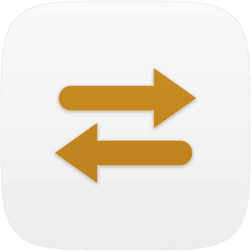

<p align="center">
  <picture>
    <source media="(prefers-color-scheme: dark)" srcset="icon-512.png">
    <source media="(prefers-color-scheme: light)" srcset="icon-512-light.png">
    
  </picture>
</p>

<h1 align="center">Deft</h1>

<p align="center"><b>Default apps for every file type and link — a Mac app (Apple silicon)</b></p>

<p align="center">
  Version <b>0.1.1</b> · released 08 Nov 2026 ·
  <a href="https://github.com/JKS-sys/Deft-23-sep-2026-releases/releases/latest">Download</a> ·
  <a href="https://ipconfig.co.network/deft">Website</a> ·
  <a href="RELEASE-NOTES.md">Release notes</a>
</p>

<p align="center">
  <a href="https://github.com/JKS-sys/Deft-23-sep-2026-releases/stargazers"></a>
</p>

<p align="center"><b>If Deft helps you, please <a href="https://github.com/JKS-sys/Deft-23-sep-2026-releases">star this repository</a> — it helps other people find it.</b></p>

Deft changes which app opens each kind of file and link on your Mac: one type at a time, a **whole category at
once** (every image, every video, every code file), or everything one app can open. The choices are stored by
macOS itself, so Deft never has to keep running — no menu bar icon, nothing in the background.

## What it does

- **File Types** — 19 categories and over 350 types (documents, images, audio, video, code, archives, fonts, 3D,
  e-books, links like `https://`, `mailto:`, `tel:` and more). Pick an app per type, or *Set all* for the category.
- **By App** — choose an app and make it the default for everything it can open, in one step.
- **Health** — finds defaults that point at deleted or trashed apps, duplicate copies and mismatched siblings
  (`.jpg` vs `.jpeg`) and fixes them in one click.
- **Your Choices** — every default set on this Mac, by Deft, Finder or anything else, read straight from macOS.
- **Activity and Undo** — every change is kept; undo any batch.
- **Profiles (Deft Pro)** — save your whole setup and restore it after a reinstall or on another Mac. Export and
  import in the `duti` file format.
- **Repair** — rebuild Launch Services when *Open With* menus or icons go stale.
- Light and dark themes, six list layouts, four window layouts, drawn icons, animations and quiet sound effects.

## Install

Download `Deft_0.1.1_aarch64.dmg` from the
[latest release](https://github.com/JKS-sys/Deft-23-sep-2026-releases/releases/latest), open it and drag Deft to
Applications. Or in Terminal:

```bash
curl -fsSL https://ipconfig.co.network/updates/deft/install.sh | bash
```

Deft updates itself (Help → Check for Updates). Needs macOS 11 or later on Apple silicon.

## Deft Pro

Free: every type, whole categories, By App, Health, Your Choices, Undo and Export.
Pro adds Profiles and Import — ₹20 a month, or ₹220 a year (one month free). Activation codes work too.

## Support

- Website: <https://ipconfig.co.network/deft>
- Email: JKS.sys@icloud.com
- Sponsor: <https://razorpay.me/@NSBJKS>

© 2026 Jagadeesh Kumar S. All rights reserved.
